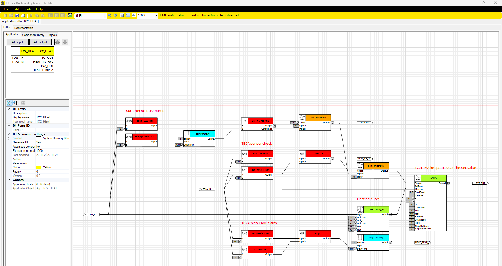

# ouflex-ba-tool: a Claude skill for Ouman Ouflex BA Tool

Lets an AI coding agent (Claude Code) program Ouflex BA Tool for you: you describe the plant, the agent writes a
plan of function blocks, builds the applications and the project in the real tool, and checks the result against
the plan.

BA Tool has no scripting interface. The skill starts the real tool inside a small host process and runs PowerShell
on the tool's own user interface thread, so the editor's own code places the blocks, draws the wires and saves the
files. Nothing writes project files behind the tool's back. This is undocumented behaviour of one tool version
(2.130.14.1) and may break on another.

What is in the skill:

- `SKILL.md`: what the agent reads first.
- `reference/findings.md`: how the tool works inside, as far as it was worked out, each fact marked proven, seen or
  untested. `reference/new-program.md` and `reference/design-rules.md`: how to get from a description to a program.
- `scripts/`: the driver. Start a hosted tool instance, run a script inside it, mouse, keyboard and screenshots,
  and `build.sh`, which builds and verifies a whole program.
- `pipeline/`: Python. Plan library, plan checker, build script generator with page layout, verifier.
- `examples/dh-ex2/`: a worked example, a district heating substation (Finnish Energy K1/2013, example
  connection 2): 4 applications, 32 function blocks, 23 set values, 16 measurements.
- `examples/dh2/`: a second example, two heating circuits with night setback by time programs, texts in three
  languages, the controller's display menu, a Web UI page and a simulator scenario (`pipeline/sim_test.py`).



## What you need

Everything on one Windows machine, your laptop is fine:

- Ouman Ouflex BA Tool, installed and activated with your own licence. Worked out on version 2.130.14.1.
- Claude Code for Windows (it brings Git Bash, which runs the scripts).
- Python 3.

No controller is needed and none is touched: the skill builds project files.

## Install

In Git Bash:

```bash
git clone https://github.com/Maxxis20/ouflex-ba-tool-skill ~/.claude/skills/ouflex-ba-tool
```

That is all you must do by hand. Start Claude Code and say what you want, for example "check that the Ouflex
skill is ready on this machine" or straight away "build an Ouflex program for an air handling unit with ...". The
agent runs a check first, sets up what it can, and asks you for the rest:

- anything missing on the machine (BA Tool, its licence activation, Python);
- an administrator shell, once, if the tool folder is not writable for you (the host program has to sit in it);
- "Cancel" on a Windows Firewall question the first time the tool starts in the host.

Set-up compiles the host (about 100 lines of C#, in `scripts/win/AgentHost.cs`) with the compiler that ships
with Windows, reads the block library of your own installation into `reference/`, and lets the tool create an
empty project to build from. Those files are Ouman's data, so they are made on your machine and are not in this
repository.

## By hand, if you want to see it work first

```bash
cd ~/.claude/skills/ouflex-ba-tool
scripts/batool.sh check                                   # what is ready, what is not
scripts/batool.sh setup                                   # work folder C:\agentwork, host, block library, base project
cp /c/Ouman/OuflexBATool_2.130.14.1/Template/NewApplication.ouear /c/agentwork/apps/First.ouear
scripts/hstart.sh ab ApplicationBuilder.exe 'C:\agentwork\apps\First.ouear' mode=1 lang=en-GB
HNAME=ab scripts/hrun.sh -c '$cv=AppCanvas; B $cv "and1" "And" 300 120 @(); Check $cv; Save-App; Dump-App $cv'
scripts/batool.sh shot first.png                          # a screenshot of your desktop
scripts/batool.sh hstop                                   # close the hosted tool
scripts/build.sh examples/dh-ex2                          # the whole example, a few minutes
```

The fifth line places an And block in the open application, runs the tool's own check, saves, and prints what the
tool now holds. `C:\agentwork\apps\First.ouear` opens in the normal Application Builder like any other file.

**Hands off the keyboard and mouse while a command runs.** Tool windows open and close on your desktop. Builds
do not click or type; `gui.sh` does, when the agent uses it to look at something by hand.

## Limits, plainly

- Worked out and tested on one machine only: BA Tool 2.130.14.1 on Windows 11, tool language English, screen
  1920x1440 at 100 % scaling, an account with administrator rights. There `check`, `setup` (host compiled, block
  library read, base project made by code) and the full build of the example passed, the build twice: once into a
  new project and once into a copy of the base project. All seven comparisons with the plan said OK each time.
- Not yet run under Git Bash. The PowerShell side (`scripts/win/cli.ps1` and everything behind it) was run
  directly. The bash wrappers in `scripts/*.sh` were only syntax-checked, and the two Python steps of the example
  build (generate, verify) ran on another computer, because the test machine has neither Git Bash nor Python.
  Expect the first faults in paths and quoting between bash and PowerShell.
- `examples/dh2` and `pipeline/sim_test.py` were built and run with the same helpers, but driven from another
  computer, not through this repository's local scripts. The display menu and Web UI scripts have no build stage
  here (run them by hand, see `examples/dh2/README.md`).
- Not tried: other tool versions, other Windows versions, an account without administrator rights, display
  scaling other than 100 %.
- Tied to tool internals: private fields and methods of BA Tool 2.130.14.1, found by reading its objects at run
  time. Another version can rename any of them. The findings say how each fact was found, so the agent can often
  work out a fix. Tell me what broke: issues are welcome.
- Building is proven up to a saved project that passes the tool's own check and matches the plan field by field.
  That is structure, not behaviour: nothing here proves a program controls a plant correctly.
- Not solved: alarm objects, time programs, the local / remote set value pattern, custom (Pawn or C) blocks,
  offline simulation. Ouflex A base unit and the FLEX UI8 module are the only hardware types used so far.
- The skill never connects to a controller. Loading a program replaces what a live controller runs; that step is
  yours, by hand, in the tool.
- One command at a time, and nobody else on the keyboard while it runs.
- The engineering is still yours: check what the agent built before it goes anywhere near a real plant.

## Not affiliated

An independent project, not made, endorsed or supported by Ouman. Ouman and Ouflex are trademarks of Ouman Oy. No
Ouman software or files are included; you need your own licensed installation.

MIT licence.
