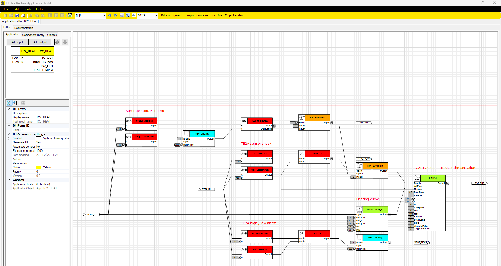
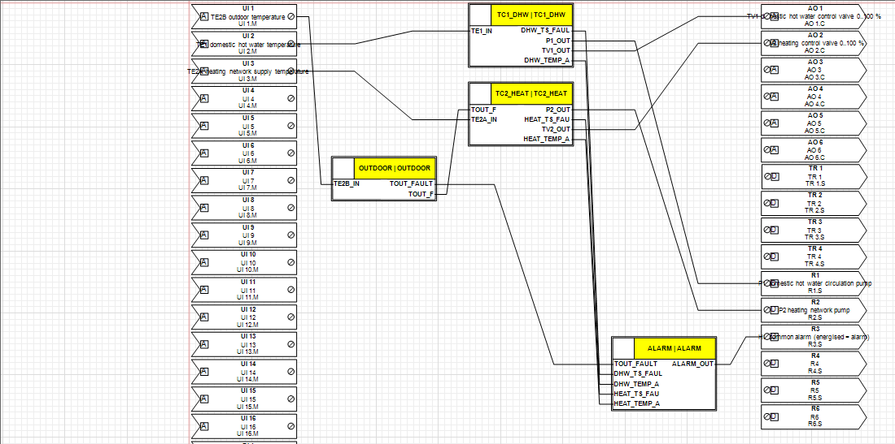

# DH-ex2: district heating substation, worked example

Domestic hot water and one heating circuit, one control valve and one pump each, after example connection 2 of
Finnish Energy's publication K1/2013 (District heating of buildings, regulations and guidelines), for one Ouman
Ouflex A base unit. An AI agent built it with this skill from `DESCRIPTION.md`.

4 applications, 32 function blocks, 23 set values, 16 measurements, 8 physical points, 6 signals between
applications.





| File | What |
|---|---|
| `DESCRIPTION.md` | description of operation: I/O, control functions, set values, measurements, what is left out |
| `make_plan.py` → `plan.json` | the generator and the plan it writes: blocks, pin sources, set values, measurements, nets |
| `layout.json` | hand layout of the four application pages and of the device page |
| `program.json` | where things go on the Windows machine, the Modbus register rule, I/O kinds |

Applications, run in this order: `OUTDOOR` (outdoor sensor check, fallback, filter), `TC1_DHW` (hot water: pump,
PID to valve TV1, temperature alarm), `TC2_HEAT` (heating: summer stop, pump, heating curve, PID to valve TV2,
temperature alarm), `ALARM` (common alarm relay).

## Build it

Set-up from the main README done (`scripts/batool.sh check` shows no TODO), from the skill folder:

```bash
python examples/dh-ex2/make_plan.py             # optional: writes plan.json again
python pipeline/check_plan.py examples/dh-ex2   # structure check of the plan
scripts/build.sh examples/dh-ex2                # generate scripts, build the four applications and the project, verify
```

The tool part of the build took 1 min 44 s on the test machine. Hands off keyboard and mouse meanwhile. It makes
`C:\agentwork\apps\dh-ex2\<APP>.ouear` and a new project `C:\agentwork\proj\DH-ex2`, and writes dumps, verification
results, screenshots and the exported Modbus document to `examples/dh-ex2/build/out/`. Open the project in BA
Tool like any other.

## Checked and not checked

Checked on 2026-11-22 with BA Tool 2.130.14.1, by the build itself:

- each application passes the tool's own check and, after saving and reopening, holds what the plan says: blocks
  with type, version, position and execution order, wires, constants, set values, measurements, interface pins,
  labels;
- the project with the four applications imported and wired to the physical points passes the tool's check for
  every application; the tool reports 14 % of the programming capacity used;
- the Modbus registers in the exported document follow the rule in `program.json`;
- the saved `Device.bin`, read without the tool, matches the plan.

In that test the two Python steps (generate, verify) ran on another computer than the tool; see "Limits" in the
main README.

Not checked: what the program does. Nothing here has run on a controller. Block choices rest on the vendor's
documentation text (the `why=` notes in `make_plan.py` name the sentence); the open points are listed in
`DESCRIPTION.md`, section 8. The PID tuning values are starting points. An example to learn from, not a design to
commission.
