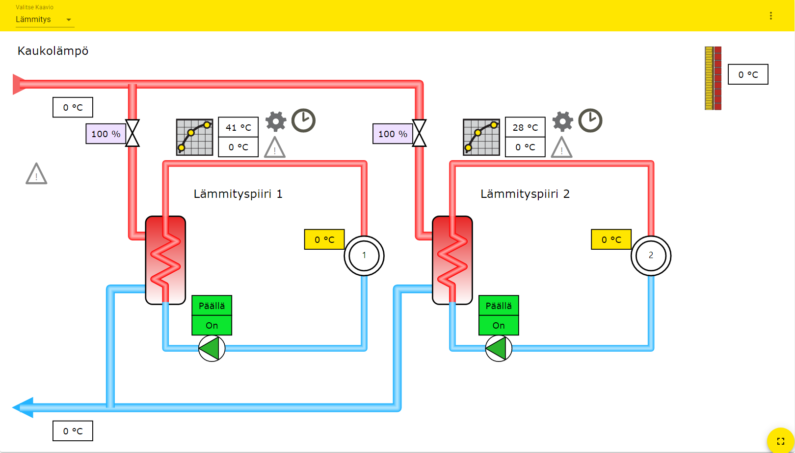
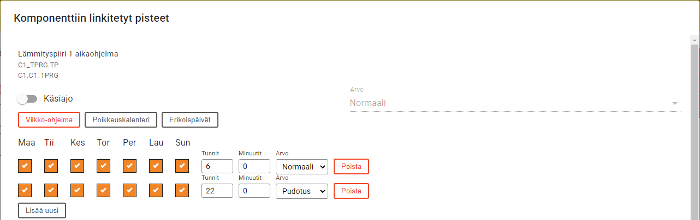
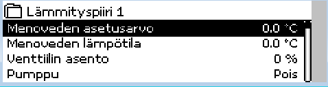
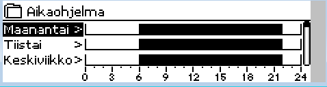

# dh2: district heating substation, two heating circuits

Two heating circuits (C1 radiators, C2 floor heating) on one Ouman Ouflex A base unit, no domestic hot water.
Per circuit: heating curve, setpoint offset and limits, **night setback by a time program**, PID valve control,
pump with summer stop and pump exercise, sensor fault handling, deviation alarm. One common alarm relay. Built by an
AI agent with this skill from `DESCRIPTION.md`.

4 applications, 73 function blocks, 38 set values, 2 time programs, 22 measurements, 10 physical points.
Texts in English, Finnish and Swedish (the pictures show the Finnish project language).



The Web UI page as built, in BA Tool's preview. The virtual Ouflex A runs the program, so the values are live:
setpoints 41 / 28 °C, pumps on, valves open, no sensors connected (0 °C). Each circuit has its heating curve, a
settings icon and a clock: the time program.



The clock opens the circuit's time program: Normaali (comfort) from 06:00, Pudotus (setback) from 22:00, every day.
The state holds over midnight until the next switch.

| The display menu: circuit 1 | Its time program on the display |
|---|---|
|  |  |

The controller's own display (BA Tool's virtual display), built from `program.json` `hmi`.

| File | What |
|---|---|
| `DESCRIPTION.md` | description of operation: I/O, control functions, set values, time programs, Modbus map, what is left out, block choices |
| `make_plan.py` → `plan.json` | the generator and the plan it writes |
| `texts.json` | translations (fi, sv) of point names and state texts; the plan holds English |
| `program.json` | where things go on the Windows machine, Modbus rule, I/O kinds, the display menu (`hmi`), Web UI page and trends |
| `make_webui.py` → `webui/heating.json` | the Web UI page (heating circuits, curves, settings, time programs) |
| `sim-C1.json` | simulator scenario for circuit C1 (9 cases, night setback included), run by `pipeline/sim_test.py` |

## Build it

Set-up from the main README done (`scripts/batool.sh check` shows no TODO), from the skill folder:

```bash
python examples/dh2/make_plan.py              # optional: writes plan.json again
python pipeline/check_plan.py examples/dh2
scripts/build.sh examples/dh2                  # applications, device, Modbus, display menu, Web UI, saved-file check
```

Every stage saves, reopens and reads back what it built, then compares it with the plan (`build/out/*.verify.txt`).

## Test it in the simulator

```bash
python pipeline/sim_test.py 'C:\agentwork\apps\dh2\C1.ouear' examples/dh2/sim-C1.json
```

BA Tool's ApplicationDebugger runs one application in a virtual Ouflex C, 100× faster than real time.

The virtual device evaluates a time program from the PC clock only when the program starts. The scenario therefore
sets the program's week with a `week` step: all Comfort for the first cases, all Setback for the setback case.

Nothing here is tested on a real controller.
